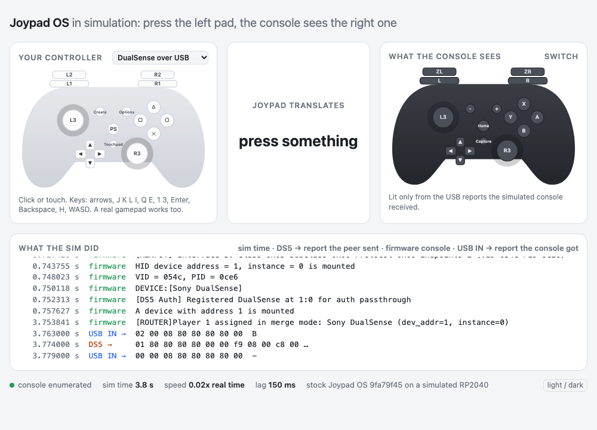
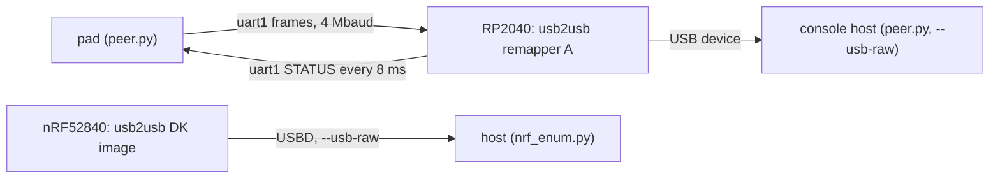
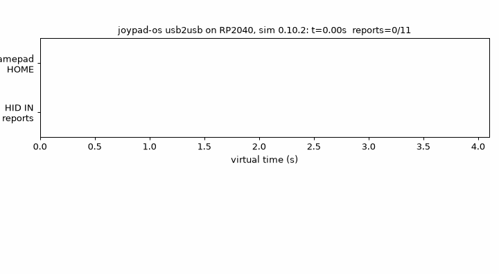
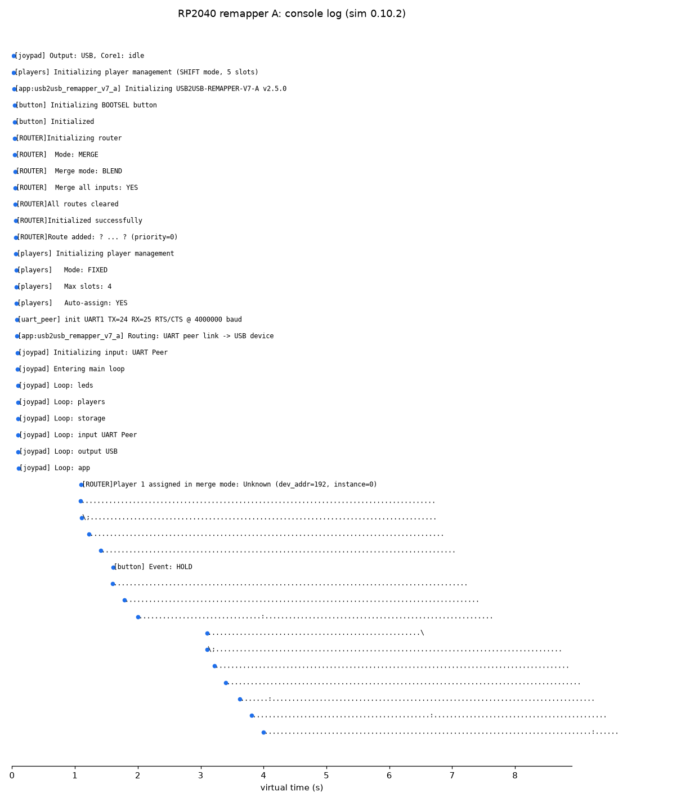
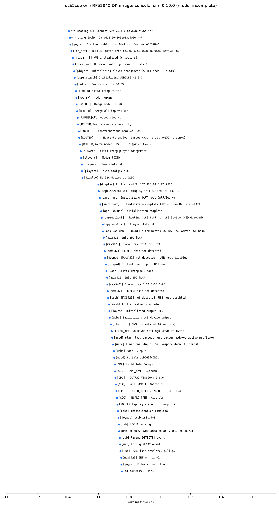
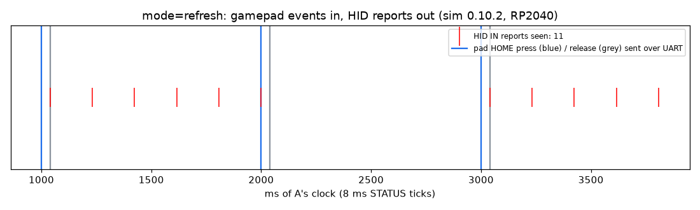

# Joypad OS, live in simulation

<!-- simantic-banner -->
> **Run this firmware with no hardware.** [Simantic](https://simantic.com) simulates the whole board, peripherals, sensors and buses included. Try it free at **[simantic.com](https://simantic.com)**, or run it locally: `curl -fsSL https://simantic.com/install | sh`




*Speed-adjusted playback of a real run: the simulator ran at 0.14-0.28x real time, so waiting is cut (about 11 s shown). The log under the pads is the run itself, stamped in simulated time: the report the DualSense peer sent, the stock firmware's console, and the report the console received.*

Press a DualSense in your browser; stock Joypad OS on a simulated RP2040 translates it; the right pad is what a Switch receives over USB.

```sh
SRC=ds5 SIM=/path/to/sim sim/live/demo
```

- [`sim/live/`](sim/live/): the live page
- [`sim/mcp/`](sim/mcp/): joypad-mcp drives the sim
- [`sim/ci/`](sim/ci/): peers and per-PR scenarios

## Details

## Simulation showcase (Simantic fork)

This fork runs unmodified Joypad OS firmware images on [Simantic](https://simantic.dev)'s `sim` (release 0.10.0 for most rows; the RP2040 gamepad row re-measured on 0.10.8), with scripted Python peers standing in for the host, the gamepad and the partner board. Licence of this repository: **Apache-2.0** (see `LICENSE`); the images in `sim/elf/` are builds of this code base and carry the same licence. Everything is in `sim/`: `run.sh`, `run_nrf.sh`, `peer.py`, `nrf_enum.py`, plotting scripts, `out/` (captured logs) and `screenshots/`.



| Configuration | Command | Image | Result (MEASURED, 2026-11-16, sim 0.10.0; nRF52840 rows re-measured 2026-11-24, sim 0.10.8) |
| --- | --- | --- | --- |
| RP2040 remapper A: boot and console | `sim/run.sh refresh` | `a_ps5default_2145ffa8.elf` (PS5 default, RP2040) | boots; 25 console lines by 0.10 s; `[button] Event: HOLD` at 1.603 s; screenshot 01 |
| RP2040: USB enumeration | same | same | device 2b81:0101 configured, HID IN endpoint 0x81 |
| RP2040: gamepad HOME presses through the adapter to the console | `sim/run.sh change`, `sim/run.sh refresh` | same | **works on sim 0.10.8 (build 64f89c38, MEASURED 2026-11-24; same numbers on 0.10.2)**: 3 HOME presses sent over UART, 11 HID reports reach the console and 12 sign requests; the console sees HOME DOWN/UP at 1040/1232 ms and 3040/3232 ms. On 0.10.0 and earlier (also 0.8.12, 0.9.0, 0.9.2) the same ELF gave 0 reports: a simulator bug, now fixed (the RP2040 clock wrapper `ClockGated` forwarded `host_rx()` but not `uart_rx()`, so `--uart-tcp`/`--uart-pty` bytes never reached the PL011) |
| nRF52840 usb2usb DK image: boot | `sim/run_nrf.sh` | `usb2usb_nrf52840dk.elf` | **re-measured on sim 0.10.8 (build 64f89c38, MEASURED 2026-11-24)**: boots to `Entering main loop` at 0.785 s virtual (0.10.0: 0.75 s); the sim still warns `NRF52840QIAA's model is incomplete` and still does not list it in `sim models` (unchanged); screenshot 02 is from 0.10.0 |
| nRF52840: USBD enumeration | `sim NRF52840QIAA run --elf sim/elf/usb2usb_nrf52840dk.elf --timeout 3 --usb-capture usbd:nrf.pcap` | same | **reaches Configured on sim 0.10.8 (MEASURED 2026-11-24)** with the simulator's built-in USB host: GET_DESCRIPTOR(device) 18 B, SET_ADDRESS, config 9 B, full config 157 B (wTotalLength 0x9d, 5 interfaces), SET_CONFIGURATION. The earlier 9-byte stop came from `sim/nrf_enum.py` (`--usb-raw`), which reads only the config header, not from the model. Host-driven bus reset: pyrite PR 4447 (not in a release yet) |
| nRF52840: gamepad through the adapter | n/a | n/a | not run: the MAX3421E SPI face still has no peer on 0.10.8 (MEASURED 2026-11-24: `[max3421] ERROR: chip not detected`, probe rev 0x00; no MAX3421E device model found in pyrite or sim-fixtures, only a comment in `nrf52840_spi.rs` saying one is needed; unchanged from 0.10.0), and the UART inject path (`uart_host`) is not in this repository's `main` |



*Playback of a captured run (virtual time), not real time: sim 0.10.2 (build 83eb7a66; re-run on 0.10.8 gives the same 11 reports), 4.1 s of virtual time shown (run bound 8 s), about 43 s wall for `sim/run.sh refresh`. Gamepad HOME press/release (triangles), the 11 HID IN reports (squares) and the console lines, all from `sim/out/refresh.*`.*





**Update (2026-11-24).** Re-run on sim 0.10.8 (build 64f89c38): 11 HID reports, 12 sign requests, HOME DOWN/UP at 1040/1232 ms and 3040/3232 ms, unchanged. Earlier, on sim 0.10.2 with the simulator fix: 11 HID reports and 12 sign requests for the same three HOME presses (the chart above and the table row are from that run). The earlier 0-report result on 0.10.0 and older was a simulator bug, not firmware, and not the PL011 RTS/CTS fix (that fix is in 0.10.0 and works). `Player 1` in A's STATUS frames is hardcoded in `usb2usb_remapper_v7_a/app.c` (`st.player_number = 1`, flags = CONNECTED), so it is not evidence of a player assignment. That older dev builds delivered the bytes is `unverified`.

Provenance and simplifications:

- `sim/elf/*.elf` are prebuilt, not built here. The nRF image banner says JOYPAD_VERSION 2.3.0, GIT_COMMIT 4a6b3c1d, board `xiao_ble`, from a branch adding the nRF52840 DK target and `uart_host`; that source is not in this tree. Rebuilding from source: `unverified`.
- MODELED SIMPLIFICATION: `peer.py` stands in for the console, the dongle, board B and the pad as one scripted peer; it counts A's 8 ms STATUS frames as its clock and answers sign requests immediately.
- No bench comparison against silicon was made for these runs.

Run: `sim/run.sh refresh` (needs `sim` on PATH, `python3`, `nc`); plots need `matplotlib`.

# Joypad OS

<p align="center">
  <picture>
    <source media="(prefers-color-scheme: dark)" srcset="docs/images/logo_solid.svg">
    <source media="(prefers-color-scheme: light)" srcset="docs/images/logo_solid_black.svg">
    
  </picture>
</p>
<p align="center">
  <strong>The Open-Source Firmware Platform for Game Controllers and Adapters</strong>
</p>
<p align="center">
  Build controller adapters, custom controllers, and assistive input devices — <br>on microcontrollers, not computers.
</p>
<p align="center">
  <a href="https://github.com/joypad-ai/joypad-os/releases"></a>
  <a href="https://github.com/joypad-ai/joypad-os/blob/main/LICENSE"></a>
  <a href="https://github.com/joypad-ai/joypad-os/actions/workflows/build.yml"></a>
  <a href="https://docs.joypad.ai/"></a>
  <a href="http://community.joypad.ai/"></a>
</p>

---

## What is Joypad OS?

Joypad OS is firmware that runs on small microcontroller boards (RP2040, ESP32-S3, nRF52840) — the kind you'd find inside a controller or adapter, not on a PC. You flash it onto a chip and it handles everything: reading controllers, translating protocols, routing inputs to outputs, and managing button remapping.

**What you can build with it:**

- **Controller adapters** — Use any modern USB or Bluetooth controller on retro consoles (GameCube, Dreamcast, PCEngine, 3DO, and more) or convert retro controllers to USB
- **Custom controllers** — Wire up buttons, sticks, and sensors to a microcontroller and get a USB gamepad that works everywhere
- **Assistive gaming setups** — Merge multiple input devices (switches, joysticks, eye trackers) into a single controller output using flexible input routing
- **Wireless adapters** — Turn any Bluetooth controller into a wired USB gamepad for low-latency play

Under the hood, Joypad OS normalizes every input source into a common format, routes it through configurable player slots, and translates it into whatever output protocol the target needs — from retro console protocols bit-banged via PIO to modern USB HID and XInput.

Formerly known as **USBRetro**.

---

## I Have an Adapter — How Do I Update It?

1. **Download** the latest `.uf2` for your adapter from [Releases](https://github.com/joypad-ai/joypad-os/releases)
2. **Enter bootloader**: Hold BOOT + connect USB-C (or double-tap reset)
3. **Drag** the `.uf2` file onto the `RPI-RP2` drive that appears
4. **Done** — the drive ejects and your adapter is running the new firmware

**[Full installation guide](docs/getting-started/installation.md)** — troubleshooting, LED status codes, profile switching

---

## I Want to Build Something — Where Do I Start?

### Quick Start (RP2040)

```bash
# Install ARM toolchain (macOS)
brew install --cask gcc-arm-embedded cmake git

# Clone and initialize
git clone https://github.com/joypad-ai/joypad-os.git
cd joypad-os && make init

# Build an adapter
make usb2gc_kb2040     # USB/BT → GameCube
make usb2usb_feather   # USB/BT → USB HID
make bt2usb_pico_w     # Bluetooth → USB
make snes2usb_kb2040   # SNES controller → USB
```

### ESP32-S3

```bash
make init-esp                   # One-time ESP-IDF setup
make bt2usb_esp32s3             # Build
make flash-bt2usb_esp32s3       # Flash
```

### nRF52840

```bash
make init-nrf                               # One-time NCS setup
make bt2usb_seeed_xiao_nrf52840             # Build
make flash-bt2usb_seeed_xiao_nrf52840       # Flash
```

Output: `releases/joypad_os_<commit>_<app>_<board>.uf2`

**[Full build guide](docs/getting-started/building.md)** — prerequisites, all targets, ESP32/nRF setup, troubleshooting

---

## What Can It Do?

### Console Adapters

Use any USB or Bluetooth controller on retro consoles:

| Console | Apps | Highlights | Build | Docs |
|---------|------|-----------|-------|------|
| **PlayStation 4** | usb2usb | Local RSA auth, passthrough, rumble | [DIY](docs/hardware/diy.md) | [Guide](docs/architecture/ps4_auth.md) |
| **PCEngine / TurboGrafx-16** | usb2pce | Multitap (5 players), mouse, 2/3/6-button | [DIY](docs/hardware/diy.md) | [Guide](docs/apps/usb2pce.md) |
| **GameCube / Wii** | usb2gc, bt2gc | Profiles, rumble, keyboard mode | [Build](docs/hardware/builds/usb2gc.md) | [Guide](docs/apps/usb2gc.md) |
| **Sega Dreamcast** | usb2dc | Rumble, analog triggers, 4 players | [DIY](docs/hardware/diy.md) | [Guide](docs/apps/usb2dc.md) |
| **N64** | bt2n64 | Rumble pak emulation, profiles, BT | [DIY](docs/hardware/diy.md) | [Guide](docs/apps/bt2n64.md) |
| **Nuon DVD Players** | usb2nuon, bt2nuon | Controller, spinner (Tempest 3000), IGR | [DIY](docs/hardware/diy.md) | [Guide](docs/apps/usb2nuon.md) |
| **3DO Interactive Multiplayer** | usb23do | 8 players, mouse, extension passthrough | [DIY](docs/hardware/diy.md) | [Guide](docs/apps/usb23do.md) |
| **Neo Geo / SuperGun** | usb2neogeo | 7 profiles, 1L6B arcade layouts | [DIY](docs/hardware/diy.md) | [Guide](docs/apps/usb2neogeo.md) |
| **Casio Loopy** | usb2loopy | 4 players (experimental) | [DIY](docs/hardware/diy.md) | [Guide](docs/apps/usb2loopy.md) |

### USB & Wireless Adapters

| Adapter | What It Does | Platforms | Build | Docs |
|---------|-------------|-----------|-------|------|
| **USB2USB** | USB/BT controller → USB gamepad (XInput, PS3/4, Switch, etc.) | RP2040, nRF52840 | [DIY](docs/hardware/diy.md) | [Guide](docs/apps/usb2usb.md) |
| **BT2USB** | Bluetooth controller → wired USB gamepad | Pico W, ESP32-S3, nRF52840 | [Pico W](docs/hardware/builds/bt2usb-pico-w.md) | [Guide](docs/apps/bt2usb.md) |
| **WiFi2USB** | WiFi controller (JOCP) → USB gamepad | Pico W | [DIY](docs/hardware/diy.md) | [Guide](docs/apps/wifi2usb.md) |

### Native Controller Adapters

Convert retro controllers to USB or bridge them to other consoles:

| Adapter | From → To | Build | Docs |
|---------|----------|-------|------|
| **SNES2USB** | SNES/NES → USB | [KB2040](docs/hardware/builds/snes2usb-kb2040.md) | [Guide](docs/apps/snes2usb.md) |
| **NES2USB** | NES → USB | [DIY](docs/hardware/diy.md) | [Guide](docs/apps/nes2usb.md) |
| **N642USB** | N64 → USB | [DIY](docs/hardware/diy.md) | [Guide](docs/apps/n642usb.md) |
| **GC2USB** | GameCube → USB | [DIY](docs/hardware/diy.md) | [Guide](docs/apps/gc2usb.md) |
| **NEOGEO2USB** | Neo Geo arcade stick → USB | [DIY](docs/hardware/diy.md) | [Guide](docs/apps/neogeo2usb.md) |
| **LodgeNet2USB** | LodgeNet hotel controllers → USB | [Pico](docs/hardware/builds/lodgenet2usb-pico.md) | [Guide](docs/apps/lodgenet2usb.md) |
| **N642DC** | N64 → Dreamcast | [KB2040](docs/hardware/builds/n642dc-kb2040.md) | [Guide](docs/apps/n642dc.md) |
| **N642Nuon** | N64 → Nuon | [DIY](docs/hardware/diy.md) | [Guide](docs/apps/n642nuon.md) |
| **SNES23DO** | SNES → 3DO | [DIY](docs/hardware/diy.md) | [Guide](docs/apps/snes23do.md) |
| **LodgeNet2N64** | LodgeNet → N64 | [DIY](docs/hardware/diy.md) | [Guide](docs/apps/lodgenet2n64.md) |
| **LodgeNet2GC** | LodgeNet → GameCube | [DIY](docs/hardware/diy.md) | [Guide](docs/apps/lodgenet2gc.md) |

### Custom Controllers

Wire up GPIO buttons and analog sticks to build your own USB gamepad:

```bash
make controller_fisherprice_v1_kb2040  # Digital buttons → USB HID
make controller_fisherprice_v2_kb2040  # Buttons + analog stick → USB HID
make controller_macropad               # Adafruit MacroPad → USB HID
make universal_pico_w           # GPIO+JoyWing → BLE+USB HID (Pico W)
make universal_rp2040_abb       # GPIO+USB Host → USB HID (ABB Passthrough)
```

---

## Supported Input Devices

- **Xbox** — OG, 360, One, Series X|S (USB + Bluetooth)
- **PlayStation** — Classic, DS3, DS4, DualSense (USB + Bluetooth)
- **Nintendo** — Switch Pro, Switch 2 Pro, Joy-Con, NSO GameCube, GameCube adapter (USB + Bluetooth)
- **8BitDo** — PCE 2.4g, M30, NeoGeo, BT adapters
- **Other** — Hori, Logitech, Google Stadia, Sega Astro City, generic HID
- **Peripherals** — USB keyboards, mice, hubs, Bluetooth dongles
- **Native** — SNES, N64, GameCube, Neo Geo, LodgeNet hotel controllers (directly wired)

**[Full controller compatibility list](docs/hardware/controllers.md)**

---

## How It Works

```
Any Input                        Router                       Any Output
─────────                        ──────                       ──────────
USB controllers ──┐                                           ┌──→ Retro consoles
Bluetooth ────────┤                                           ├──→ USB gamepad
WiFi ─────────────┼──→  normalize  →  route  →  translate  ──┼──→ XInput / PS4 / Switch
SNES / N64 / GC ──┤         ↓                                ├──→ Keyboard + mouse
GPIO buttons ─────┘    profile_apply()                        └──→ Custom outputs
                    (button remapping)
```

- **Router** — SIMPLE (1:1), MERGE (all→one), or BROADCAST (all→all) modes
- **Profiles** — Per-app button remapping, cycled via SELECT + D-pad
- **Dual-Core** — Core 0 handles input, Core 1 handles timing-critical output (RP2040)
- **PIO** — Programmable I/O for console protocols (GameCube joybus, Dreamcast maple, etc.)

**[Architecture overview](docs/overview/architecture.md)** | **[Data flow](docs/overview/data-flow.md)**

---

## Platforms

| Platform | Chip | What Runs On It | Bluetooth | Build System |
|----------|------|----------------|-----------|--------------|
| **RP2040** | ARM Cortex-M0+ (dual-core) | All console adapters, USB output, custom controllers | Classic BT + BLE (Pico W) or via dongle | pico-sdk |
| **ESP32-S3** | Xtensa LX7 (dual-core) | bt2usb | BLE only | ESP-IDF |
| **nRF52840** | ARM Cortex-M4 | bt2usb, usb2usb | BLE only | nRF Connect SDK |

---

## Documentation

| Section | What's There |
|---------|-------------|
| **[Installation Guide](docs/getting-started/installation.md)** | Flashing firmware, troubleshooting, LED codes |
| **[Build Guide](docs/getting-started/building.md)** | Dev setup for macOS/Linux/Windows, all build targets |
| **[Supported Controllers](docs/hardware/controllers.md)** | USB, Bluetooth, keyboards, mice, dongles |
| **[Supported Boards](docs/hardware/boards.md)** | RP2040, ESP32-S3, nRF52840 board comparison |
| **[Wiring Guide](docs/hardware/wiring.md)** | USB host port + console connector pinouts |
| **[DIY Builds](docs/hardware/diy.md)** | Build your own, where to buy parts |
| **[ESP32-S3](docs/platforms/esp32.md)** | ESP-IDF setup, TinyUF2, architecture |
| **[nRF52840](docs/platforms/nrf52840.md)** | nRF Connect SDK setup, debugging |
| **[Architecture](docs/overview/architecture.md)** | How it works — data flow, router, I/O layers |
| **[Data Flow](docs/overview/data-flow.md)** | Input-to-output pipeline walkthrough |
| **[Protocol Reference](docs/protocols/3DO_PBUS.md)** | 3DO PBus, GameCube Joybus, Nuon Polyface, PCEngine |

---

## Community & Support

- **Discord**: [community.joypad.ai](http://community.joypad.ai/) - Community chat
- **Issues**: [GitHub Issues](https://github.com/joypad-ai/joypad-os/issues) - Bug reports
- **Email**: support@controlleradapter.com - Product support

---

## Acknowledgements

- [Ha Thach](https://github.com/hathach/) - [TinyUSB](https://github.com/hathach/tinyusb)
- [David Shadoff](https://github.com/dshadoff) - [PCEMouse](https://github.com/dshadoff/PC_Engine_RP2040_Projects/tree/main/PCEMouse) foundation
- [FCare](https://github.com/FCare) - [USBTo3DO](https://github.com/FCare/USBTo3DO) 3DO protocol implementation
- [mackieks](https://github.com/mackieks) - [MaplePad](https://github.com/mackieks/MaplePad) Dreamcast Maple Bus implementation
- [Ryzee119](https://github.com/Ryzee119) - [tusb_xinput](https://github.com/Ryzee119/tusb_xinput/)
- [SelvinPL](https://github.com/SelvinPL/) - [lufa-hid-parser](https://gist.github.com/SelvinPL/99fd9af4566e759b6553e912b6a163f9)
- [JonnyHaystack](https://github.com/JonnyHaystack/) - [joybus-pio](https://github.com/JonnyHaystack/joybus-pio)
- [OpenStickCommunity](https://github.com/OpenStickCommunity) - [GP2040-CE](https://github.com/OpenStickCommunity/GP2040-CE) USB device output modes

---

## License

Joypad OS is licensed under the **Apache-2.0 License**.

The **Joypad** name and branding are trademarks of Joypad Inc.
