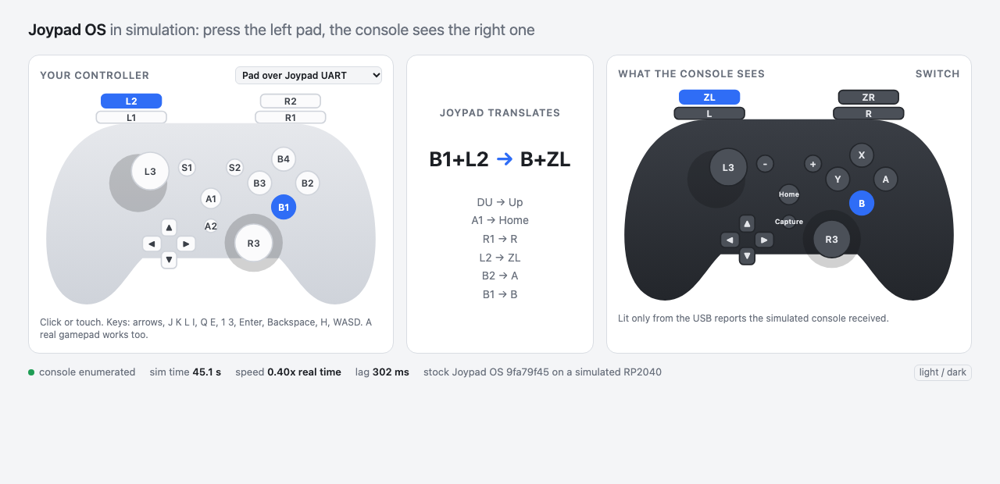

# Joypad OS live

Press a controller in your browser; stock Joypad OS on a simulated RP2040 translates it, and a simulated Switch console shows what it received.

```sh
SIM=/path/to/sim ./demo
```


